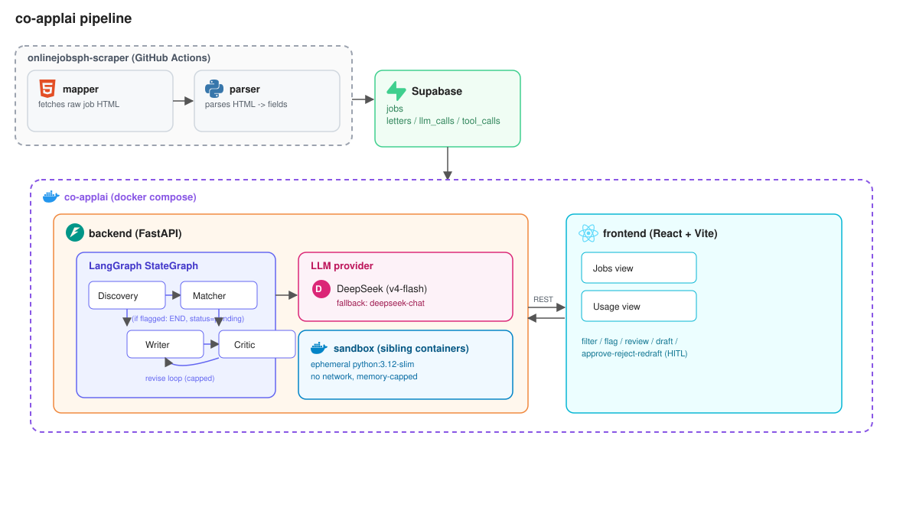

# co-applai

Drafts the short message you paste into onlinejobs.ph's "Apply" box -- not a
cover letter -- for jobs scraped by a sibling project, using a multi-agent
LangGraph pipeline with a human-in-the-loop review step.

See [`docs/architecture.md`](docs/architecture.md) for the full pipeline,
stack, and agent design, and [`docs/ERD.md`](docs/ERD.md) for the schema.

## Where this fits



`onlinejobsph-scraper`'s `mapper` service fetches raw job HTML from
onlinejobs.ph; its `parser` service parses that HTML into structured rows in
Supabase's `jobs` table. co-applai pulls those jobs, drafts an apply message against the
candidate's profile (`backend/profile.yaml`, not committed), flags jobs that
are 30+ days old or carry custom apply instructions, and runs a four-agent
(Discovery -> Matcher -> Writer -> Critic) pipeline with human review in the
loop before a message is marked approved.

## Stack

- Backend: FastAPI + LangGraph (Python), DeepSeek as the LLM provider
- Frontend: React (Vite)
- Datastore: Supabase (Postgres)
- Sandbox: ephemeral Docker containers for agent code execution
- Deployment: Docker Compose

## Running it

```
docker compose up --build -d
```

- Backend: http://localhost:8000
- Frontend: http://localhost:5173

Requires `backend/.env` (Supabase + DeepSeek credentials) and
`backend/profile.yaml` (candidate profile) -- both gitignored, not included
in this repo. The Supabase schema (`backend/schema.sql`, also gitignored) is
documented in [`docs/ERD.md`](docs/ERD.md) and applied directly via the
Supabase SQL editor.
